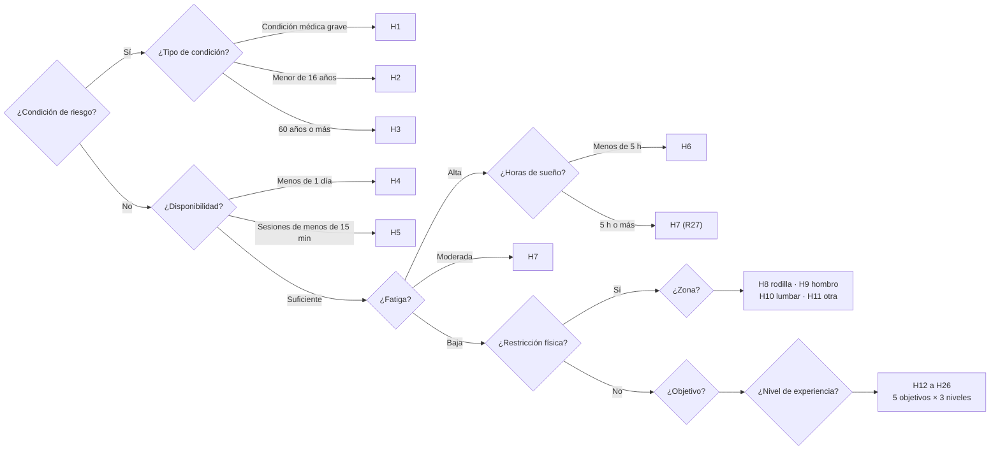

# FitExpert

**Sistema experto académico de orientación y planificación del entrenamiento.**

FitExpert es un sistema experto basado en reglas. Recorre con el usuario un árbol de decisión, convierte sus
respuestas en hechos y usa un motor de inferencia para recomendar una rutina de entrenamiento y una dieta.
Cada recomendación se justifica con las reglas que la produjeron.

Todas las salidas provienen de la base de conocimiento. FitExpert **no** es un chatbot y **no** usa modelos
de lenguaje ni servicios de inteligencia artificial generativa.

> Proyecto académico — Universidad Manuela Beltrán · Ingeniería de Software · Sistemas Expertos.
> Las recomendaciones son orientación general y **no sustituyen** la valoración de un profesional de la salud o del deporte.

---

## Contenido

- [Características](#características)
- [Arquitectura](#arquitectura)
- [Árbol de decisión](#árbol-de-decisión)
- [Motor de inferencia](#motor-de-inferencia)
- [Base de datos](#base-de-datos)
- [Estructura del repositorio](#estructura-del-repositorio)
- [Ejecución local](#ejecución-local)
- [Publicación en AWS](#publicación-en-aws)
- [API REST](#api-rest)
- [Autores](#autores)
- [Referencias](#referencias)

---

## Características

- **Evaluación guiada por el árbol de decisión.** Se muestra solo la pregunta del nodo actual, y cada
  respuesta lleva al nodo hijo hasta un nodo terminal (H1 a H26). El servidor rechaza cualquier recorrido
  que no siga una rama del árbol.
- **Reglas derivadas del árbol.** Hay una regla SI … ENTONCES por cada nodo terminal (R01 a R27). Sus
  condiciones se calculan a partir del camino del árbol, así que el árbol, las reglas y la navegación no
  pueden quedar distintos.
- **Las 5 hipótesis con mayor puntuación.** La primera es la conclusión del árbol. Las otras cuatro son las
  alternativas más compatibles según el modelo de pesos.
- **Detalle persistente.** La rutina, la dieta, la regla y la explicación de cada una de las 5 hipótesis se
  guardan en la tabla `DetalleHipotesis`, y se consultan al dar clic en una hipótesis.
- **Condiciones de riesgo.** H1 (condición médica grave), H2 (menor de 16 años) y H3 (60 años o más) muestran
  un aviso para consultar con un profesional de la salud. El recorrido termina ahí, sin alternativas.
- **Explicabilidad.** Cada resultado muestra el recorrido en el árbol, las condiciones cumplidas y no
  cumplidas, la cobertura de la evidencia y la prioridad del área.
- **Dos perfiles.**
  - **Usuario final:** evaluación, plan e historial.
  - **Administrador** (ingeniero del conocimiento): resumen de uso, árbol, reglas, edición de hipótesis y
    gestión de cuentas.

## Arquitectura

```
Navegador (wwwroot)  ──HTTPS──►  ASP.NET Core (.NET 10)  ──SQL──►  SQL Server
 index.html · app.js             API REST + motor de                Amazon RDS (producción)
                                 inferencia en C#                   o SQL Server local (pruebas)
                                 AWS Lambda (producción)
```

La interfaz, la base de conocimiento y el motor de inferencia son componentes independientes (RNF-03).
El motor no contiene conocimiento del dominio: todo se consulta en la base de datos.

## Árbol de decisión

El árbol tiene **40 nodos**: 13 de decisión, 27 terminales y 39 ramas. Evalúa primero la seguridad del
usuario, luego su disponibilidad y su recuperación, y al final su objetivo de entrenamiento.



| Área | Hipótesis | Prioridad |
|---|---|---|
| Seguridad | H1 – H3 | 100 |
| Disponibilidad | H4 – H5 | 95 |
| Recuperación | H6 – H7 | 90 |
| Restricción física | H8 – H11 | 85 |
| Entrenamiento | H12 – H26 | 50 |

## Motor de inferencia

1. **Validar el recorrido.** Cada respuesta debe ser una rama del nodo actual, hasta llegar a un nodo terminal.
2. **Consultar las reglas candidatas.** Son las reglas que tienen alguna condición entre los hechos declarados.
3. **Consultar las condiciones (parte SI) de cada regla.**
4. **Calcular la certeza de cada regla:**

   ```
   Cobertura   = suma de pesos de las condiciones cumplidas / suma de pesos de la regla
   Soporte     = condiciones cumplidas / condiciones de la regla
   Certeza     = Cobertura × (0,2 + 0,8 × Soporte) × Prioridad / 100
   ```

   El peso de cada condición crece con su profundidad en el árbol: la condición más específica aporta más
   evidencia.

5. **Ordenar y normalizar.** Primero va la regla que se cumple completa (la conclusión del árbol). Luego
   se toman las 5 primeras hipótesis y sus pesos se reparten para sumar 100 %. Si la conclusión es una
   condición de riesgo, solo se devuelve esa hipótesis.

## Base de datos

El script [`FitExpertDB_AWS.sql`](FitExpertDB_AWS.sql) crea la base `FitExpertDB` completa, con sus datos,
sus vistas y unas consultas de verificación.

| Tabla | Propósito |
|---|---|
| `Pregunta` | Preguntas que formulan los nodos de decisión |
| `Hecho` | Respuestas posibles de cada pregunta (ramas del árbol) |
| `Hipotesis` | Conclusiones H1 a H26, con rutina, dieta, prioridad y aviso de riesgo |
| `NodoDecision` | Árbol de decisión (relación recursiva al nodo padre) |
| `Regla` | Una regla por nodo terminal (R01 a R27) |
| `CondicionRegla` | Parte SI de cada regla, con su peso |
| `Usuario` | Cuentas de acceso (contraseña con PBKDF2-SHA256 y sal) |
| `Evaluacion` | Cada ejecución del motor de inferencia |
| `EvaluacionRespuesta` | Camino recorrido en el árbol durante la evaluación |
| `DetalleHipotesis` | Detalle de las 5 hipótesis con mayor puntuación (rutina, dieta, regla y explicación) |

| Vista | Propósito |
|---|---|
| `vw_Reglas` | Reglas en formato SI … Y … ENTONCES |
| `vw_ArbolDecision` | Árbol en formato legible |

[`FitExpert_Login_AWS.sql`](FitExpert_Login_AWS.sql) recrea solo las tablas transaccionales, sin tocar la
base de conocimiento.

## Estructura del repositorio

```
FitExpert/
├── FitExpertDB_AWS.sql          Base de conocimiento y tablas transaccionales
├── FitExpert_Login_AWS.sql      Recrea solo las tablas transaccionales
├── GUIA_AWS.md                  Guía paso a paso de despliegue en AWS
└── FitExpert.Web/
    ├── Program.cs               Rutas de la API y arranque del servicio
    ├── Motor/
    │   ├── Modelo/              Entidades: árbol, reglas, hipótesis, resultados
    │   ├── Datos/               Repositorios SQL Server
    │   └── Negocio/             Motor de inferencia, cálculo de certeza, redacción de reglas
    ├── Seguridad/               Emisión y validación de tokens JWT
    └── wwwroot/                 Interfaz web (HTML, CSS y JavaScript sin dependencias)
```

## Ejecución local

**Requisitos:**

- [.NET 10 SDK](https://dotnet.microsoft.com/download)
- SQL Server: Developer, Express o LocalDB
- SQL Server Management Studio (SSMS)

**Pasos:**

1. Clona el repositorio:

   ```bash
   git clone https://github.com/Cachureto/FitExpert.git
   cd FitExpert
   ```

2. En SSMS, conéctate a tu servidor local y ejecuta `FitExpertDB_AWS.sql`. La consulta de coherencia del
   final debe devolver **0 filas**.

3. Crea el archivo `FitExpert.Web/appsettings.Development.json`. Está excluido del repositorio porque
   contiene la cadena de conexión.

   ```json
   {
     "ConnectionStrings": {
       "FitExpertDB": "Server=localhost;Database=FitExpertDB;Trusted_Connection=True;TrustServerCertificate=True;"
     },
     "Jwt": {
       "Clave": "una-clave-larga-de-al-menos-32-caracteres"
     }
   }
   ```

   Según tu instalación, el servidor puede ser `localhost`, `localhost\\SQLEXPRESS` o `(localdb)\\MSSQLLocalDB`.

4. Ejecuta el servicio:

   ```bash
   cd FitExpert.Web
   dotnet run
   ```

   Abre la dirección que aparece en *Now listening on* (por defecto http://localhost:5000). En VS Code
   también puedes usar **F5**: ya está configurado en `.vscode/launch.json`.

**Cuentas de prueba:**

| Perfil | Usuario | Contraseña |
|---|---|---|
| Usuario final | `usuario` | `Usuario2026*` |
| Administrador | `admin` | `Admin2026*` |

## Publicación en AWS

En producción, la base de conocimiento se aloja en **Amazon RDS for SQL Server** y el servicio se publica
en **AWS Lambda** con una URL de función. El procedimiento completo está en [`GUIA_AWS.md`](GUIA_AWS.md).
En resumen:

```powershell
cd FitExpert.Web
dotnet publish -c Release -r linux-x64 --self-contained false -o publish
Compress-Archive -Path publish\* -DestinationPath fitexpert.zip -Force
```

Después sube `fitexpert.zip` a la función Lambda (Handler `FitExpert.Web`) y configura estas variables de
entorno:

- `ConnectionStrings__FitExpertDB`: cadena de conexión a RDS.
- `Jwt__Clave`: clave para firmar los tokens.

## API REST

| Método y ruta | Acceso | Descripción |
|---|---|---|
| `GET /api/salud` | Público | Estado del servicio |
| `POST /api/auth/login` · `POST /api/auth/registro` | Público | Inicio de sesión y registro |
| `GET /api/app/arbol` | Sesión | Árbol de decisión que recorre la interfaz |
| `POST /api/app/evaluar` | Sesión | Inferencia sobre las respuestas del recorrido, en orden |
| `GET /api/app/evaluaciones` | Sesión | Historial del usuario |
| `GET /api/app/evaluaciones/{id}` | Sesión | Evaluación completa |
| `GET /api/app/evaluaciones/{id}/hipotesis/{posicion}` | Sesión | Detalle de una de las 5 hipótesis |
| `GET /api/admin/resumen` · `/arbol` · `/reglas` · `/hipotesis` | Administrador | Base de conocimiento y actividad |
| `PUT /api/admin/hipotesis/{id}` | Administrador | Editar nombre, prioridad, rutina y dieta |
| `GET` · `POST /api/admin/usuarios` · `PUT /api/admin/usuarios/{id}/estado` | Administrador | Gestión de cuentas |

Ejemplo de evaluación, con los identificadores de los hechos en el orden del recorrido:

```json
POST /api/app/evaluar
{ "hechos": [2, 8, 11, 15, 21, 26] }
```

## Autores

- **Alejandro Cadrazco Mier** — Ingeniero del conocimiento
- **Andrés Felipe Galindo Quiñones** — Ingeniero del conocimiento

Docente evaluador: José Marcial Téllez Gómez · Sistemas Expertos · Universidad Manuela Beltrán, 2026.

## Referencias

- Buchanan, B. G., & Duda, R. O. (1983). Principles of rule-based expert systems. *Advances in Computers, 22*, 163–216. https://doi.org/10.1016/S0065-2458(08)60129-1
- American College of Sports Medicine. (2009). Progression models in resistance training for healthy adults. *Medicine & Science in Sports & Exercise, 41*(3), 687–708. https://doi.org/10.1249/MSS.0b013e3181915670
- Jäger, R., et al. (2017). International Society of Sports Nutrition position stand: Protein and exercise. *Journal of the International Society of Sports Nutrition, 14*, 20. https://doi.org/10.1186/s12970-017-0177-8
- World Health Organization. (2020). *WHO guidelines on physical activity and sedentary behaviour*. https://www.who.int/publications/i/item/9789240014886
